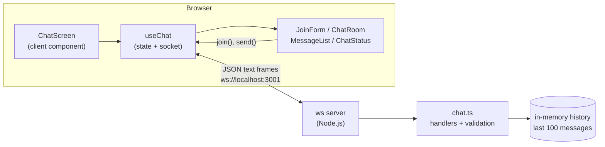
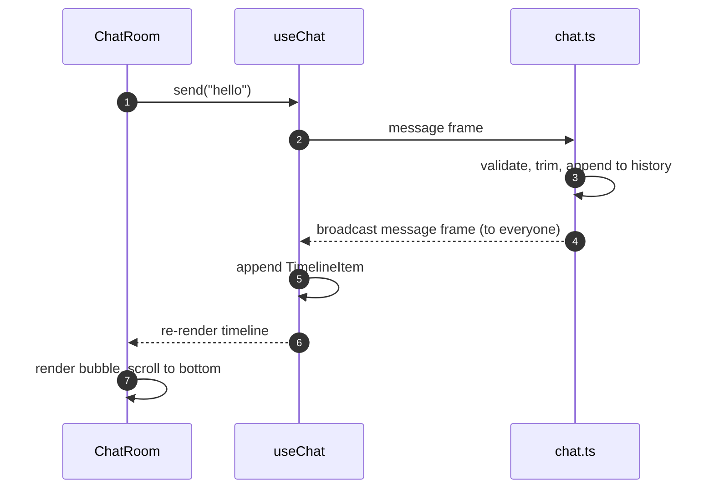
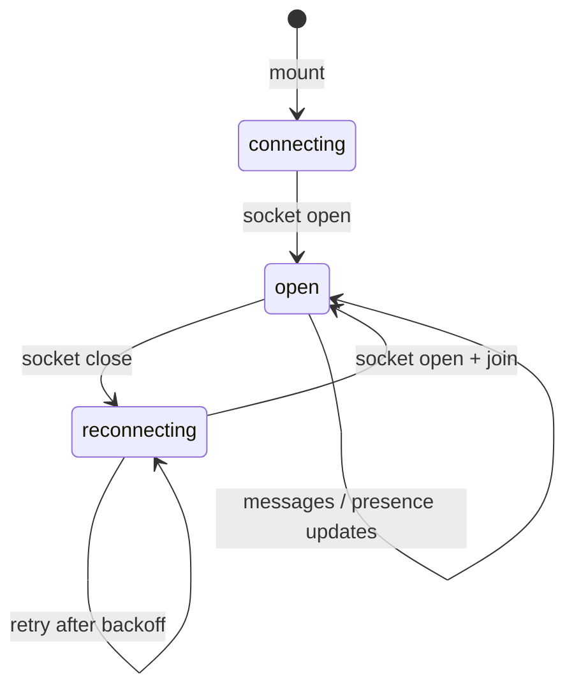

# Architecture

This document explains how the code is organized and what happens during the
two flows that matter most: sending a message and recovering from a dropped
connection.

## Bird's-eye view

The frontend never talks to Express directly. The only HTTP endpoint is
`GET /health`; everything else is a WebSocket frame.

## Repository map

| Path                                        | Responsibility                                                     |
| ------------------------------------------- | ------------------------------------------------------------------ |
| `backend/src/server.ts`                     | HTTP server, WebSocket upgrade, heartbeat, graceful shutdown.      |
| `backend/src/chat.ts`                       | Chat domain: join/message handlers, validation, history, presence. |
| `backend/src/types.ts`                      | Wire contract used by the backend.                                 |
| `frontend/lib/chat-types.ts`                | Mirror of the wire contract used by the client.                    |
| `frontend/hooks/use-chat.ts`                | Socket lifecycle, reconnection, and all chat state.                |
| `frontend/components/chat/chat-screen.tsx`  | Chooses between the join form and the chat room.                   |
| `frontend/components/chat/join-form.tsx`    | Nickname form.                                                     |
| `frontend/components/chat/chat-room.tsx`    | Full-screen room: header, message area, composer.                  |
| `frontend/components/chat/message-list.tsx` | Timeline rendering and autoscroll.                                 |
| `frontend/components/chat/chat-status.tsx`  | Shared connection indicator.                                       |
| `frontend/app/page.tsx`                     | Server Component that renders `<ChatScreen />`.                    |
| `frontend/app/layout.tsx`                   | Fonts, metadata, and the theme provider.                           |

## Backend

### `server.ts` — transport

- Creates an Express app only for `GET /health`.
- Wraps it with `http.createServer` and hands that server to
  `new WebSocketServer({ server, maxPayload: 16 * 1024 })`. The HTTP → WebSocket
  upgrade therefore happens on the same port (3001).
- Reads `PORT` and `CORS_ORIGIN` from the environment. `CORS_ORIGIN` is a
  comma-separated allowlist used both by Express CORS and by the WebSocket
  `Origin` check in `chat.ts`.
- Runs a heartbeat every 30 seconds: each socket must answer `ping` with
  `pong`, otherwise it is terminated. This cleans up connections that died
  without a proper close handshake.
- Handles `SIGINT`/`SIGTERM` by closing clients with code `1001`, stopping the
  server, and forcing exit after one second.

### `chat.ts` — domain

- Keeps the last 100 `ChatMessage` objects in a plain array (`history`).
- Keeps a `Map<WebSocket, ClientState>` where `ClientState` currently holds the
  nickname. `wss.clients` tracks sockets; this map tracks users.
- On connection, checks the `Origin` header against the allowlist and closes
  with `1008` when it does not match. Requests with no `Origin` (CLI clients,
  tests) are accepted. The allowlist is normalized at startup (whitespace and
  trailing slashes), and accepted connections and rejected origins are logged.
- Validates every incoming frame: text only, valid JSON, known `type`, and
  field-level rules (nickname length/uniqueness, message length).
- Broadcasts `message`, `system`, and `users` frames to every open socket.
- Removes the user and broadcasts a "left" notice on close.

### `types.ts` — contract

A discriminated union for client and server frames. It is the reference for
[`protocol.md`](protocol.md).

## Frontend

### `useChat` state

| Field          | Meaning                                                                           |
| -------------- | --------------------------------------------------------------------------------- |
| `status`       | Transport state: `connecting`, `open`, or `reconnecting`.                         |
| `me`           | Nickname of the joined user. It survives reconnections so the room stays visible. |
| `joined`       | `true` only after `welcome`. Distinguishes "socket open" from "in the room".      |
| `users`        | Presence list sent by the server.                                                 |
| `timeline`     | Ordered list of chat messages and local system notices.                           |
| `error`        | Last server error message, shown by the join form.                                |
| `join()`       | Stores the nickname in a ref and sends `join`.                                    |
| `send()`       | Trims and sends a `message` frame.                                                |
| `clearError()` | Clears the join error when the user edits the input.                              |

`status` and `joined` are deliberately separate:

- `status === "open"` only means the socket is connected.
- The composer is enabled only when `status === "open" && joined`.

### Socket lifecycle

All socket work happens inside one `useEffect`:

1. `connect()` creates a `WebSocket` and stores it in `socketRef`.
2. `open` resets the retry counter, sets `status` to `open`, and re-sends
   `join` if `nicknameRef` holds a nickname.
3. `message` parses JSON and dispatches to `handleMessage`.
4. `close` clears `joined`, sets `status` to `reconnecting`, and schedules
   `connect()` with exponential backoff and jitter (0.5 s → 30 s).
5. `error` closes the socket; the retry itself is handled by `close`.
6. Cleanup on unmount sets `disposed`, clears the timer, and closes the socket.
   The `disposed` flag is what makes React StrictMode's double mount safe.

### Components

- `ChatScreen` calls `useChat()` once and renders either `JoinForm` (no `me`)
  or `ChatRoom`.
- `JoinForm` enables its button only when the socket is open and the nickname
  is non-empty. Server errors (for example `NICKNAME_TAKEN`) appear inline.
- `ChatRoom` is a full-height flex column: header, scrollable message area,
  footer composer. It disables the composer unless both `status === "open"` and
  `joined`.
- `MessageList` renders `TimelineItem`s. Own messages align right with
  `bg-primary`; others align left with `bg-muted`. A sentinel `
` at the
  end is used for `scrollIntoView` autoscroll.

## The journey of a message

1. The form's `onSubmit` calls `send(text)` and clears the input.
2. `send` trims the text and `sendRaw` serializes it if the socket is open.
3. The server parses the frame, validates the text, and rejects it with an
   `error` frame if needed.
4. The server creates the `ChatMessage` (id, nickname, timestamp), appends it
   to history, and broadcasts it to every open socket, including the sender.
5. The client appends the message to the timeline. There is no optimistic
   rendering, so the server is the single source of truth.

## The journey of a reconnection

1. The TCP connection drops (server restart, network change, laptop sleep).
   The browser fires `close`.
2. `status` becomes `reconnecting`, `joined` becomes `false`, and the composer
   is disabled. The chat stays visible because `me` is still set.
3. A retry is scheduled with `min(30s, 500ms * 2^attempt)` multiplied by a
   random jitter factor.
4. When the socket opens, `status` becomes `open` and the client sends `join`
   again using the nickname stored in `nicknameRef`.
5. The server replies with `welcome`. The client replaces the timeline with
   `history` and updates `users`, then sets `joined = true`.
6. The composer is enabled again.

If the nickname is no longer available (for example, someone else took it while
the client was offline), the server answers `NICKNAME_TAKEN`. The hook clears
`me` and `nicknameRef`, so the user lands back on the join form with the error
message instead of an inconsistent state.

## Design decisions

| Decision                                | Rationale                                                                              | Trade-off                                                                  |
| --------------------------------------- | -------------------------------------------------------------------------------------- | -------------------------------------------------------------------------- |
| Plain `ws` instead of Socket.IO         | The goal is to learn the protocol: handshake, frames, broadcast, heartbeat, reconnect. | Reconnection, rooms, and acks are written by hand.                         |
| JSON text frames                        | Easy to inspect in DevTools and to build from any language.                            | Larger than a binary encoding, negligible at this scale.                   |
| Server echo instead of optimistic UI    | One source of truth for id, nickname, and timestamp; no reconciliation code.           | A small delay before the message appears.                                  |
| `welcome` as resync point               | Replacing the timeline cannot duplicate messages after a reconnect.                    | Local `system` notices from before the drop disappear.                     |
| In-memory history                       | No database or extra dependency for a learning project.                                | History is lost on restart and bounded to 100 messages.                    |
| Nickname as identity                    | Keeps the protocol small and understandable.                                           | No authentication, impersonation is possible.                              |
| Duplicated wire types                   | Avoids a monorepo setup for a two-package project.                                     | `backend/src/types.ts` and `frontend/lib/chat-types.ts` must stay in sync. |
| Full-screen layout, `max-w-3xl` content | Feels like a real chat app and stays readable on wide screens.                         | The join screen uses a centered card, a small visual inconsistency.        |

## Reading order

If you are new to the code, read it in this order:

1. `backend/src/types.ts` — the vocabulary.
2. `backend/src/server.ts` — how a WebSocket server is attached to HTTP.
3. `backend/src/chat.ts` — the actual chat behavior.
4. `frontend/lib/chat-types.ts` — the same contract on the client.
5. `frontend/hooks/use-chat.ts` — state and reconnection.
6. `frontend/components/chat/chat-screen.tsx` → `chat-room.tsx` →
   `message-list.tsx` — rendering.

## Where to change what

- **Limits** (nickname length, message length, history size): constants at the
  top of `backend/src/chat.ts`. Mirror the input `maxLength` values in
  `join-form.tsx` and `chat-room.tsx`, then update `protocol.md`.
- **A new client message**: add it to both `types.ts` files, handle it in the
  `switch` in `chat.ts`, and expose a function from `useChat`.
- **A new server message**: add it to both `types.ts` files, handle it in
  `handleMessage` in `use-chat.ts`, and render it from `TimelineItem` or as a
  new state field.
- **Persistence**: replace the `history` array in `chat.ts` with a repository
  (SQLite, for example) and load it when the server starts.
- **Rooms**: add `roomId` to `ClientState`, track rooms, and replace
  `broadcast` with a room-scoped version.
- **Allowed origins**: `CORS_ORIGIN` in `backend/src/server.ts`.
- **Reconnection policy**: `retryDelay` and `MAX_RETRY_DELAY` in
  `frontend/hooks/use-chat.ts`.
