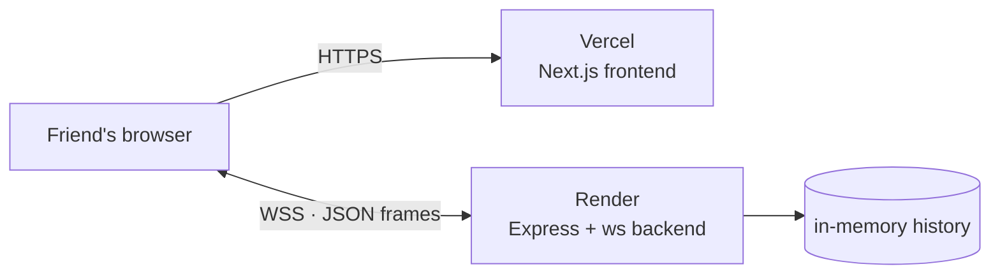

# Deployment

How to put `chatroom` online so a friend can use it: the frontend on Vercel,
the backend on Render. Railway and Fly.io notes are at the end.

## Topology



The two services are deployed separately because they have different needs:

- **Next.js** can be statically built and served from Vercel's CDN.
- **The backend** must be a long-running process holding WebSocket connections.
  Vercel functions are short-lived and cannot host a `ws` server.

The browser loads the app from Vercel and then opens a WebSocket directly to
Render, so the backend needs public TLS (`wss://`).

## Prerequisites

- The repository pushed to GitHub. The backend and frontend live in the same
  repo; each platform deploys one subdirectory.
- A [Vercel](https://vercel.com) account (Hobby plan is enough).
- A [Render](https://render.com) account (free plan works, with caveats).
- Node.js 20+ locally if you want to verify the build before deploying.

No custom domain is required. `*.vercel.app` and `*.onrender.com` work fine.

## Prepare the backend for production

`backend/package.json` runs TypeScript through `tsx`:

```json
"scripts": {
  "start": "tsx src/server.ts"
}
```

`tsx` is in `devDependencies`. Production installs that use
`NODE_ENV=production` (or `npm ci --omit=dev`) will not install it and the
service will fail with `tsx: not found`.

Pick one:

- **No code change:** use `npm ci --include=dev` as the build command on Render
  (covered below).
- **Cleaner:** move `tsx` from `devDependencies` to `dependencies` in
  `backend/package.json` and commit the change. Then `npm ci` is enough.
- **Leanest:** add a compiled build (`tsc` emit) and run `node dist/server.js`.
  This requires import extensions or a bundler, so it is more work.

The backend does **not** load `.env` files. All variables must be set in the
platform dashboard or in the shell that starts the process.

## Deploy the backend (Render)

1. In Render, choose **New → Web Service** and connect the GitHub repository.
2. Configure the service:
   - **Language:** Node
   - **Branch:** `main`
   - **Root Directory:** `backend`
   - **Build Command:** `npm ci --include=dev`
   - **Start Command:** `npm start`
   - **Health Check Path:** `/health`
   - **Instance Type:** Free (for testing)
3. Add the environment variable `CORS_ORIGIN`. You do not know the Vercel URL
   yet, so set a placeholder such as `https://example.vercel.app` and come back
   to it after step 2 of the frontend deploy.
4. Deploy and wait for the build. The logs should end with:

   ```
   [ws] backend listening on http://localhost:10000
   [ws] health check at http://localhost:10000/health
   [ws] allowed origins: https://example.vercel.app
   ```

   Render injects `PORT`; the code reads it, so no extra configuration is
   needed.

5. Copy the service URL, for example
   `https://chatroom-api.onrender.com`, and verify it:

   ```bash
   curl https://chatroom-api.onrender.com/health
   # {"ok":true,"clients":0}
   ```

   The WebSocket endpoint is the same host with the `wss://` scheme:
   `wss://chatroom-api.onrender.com`.

### Free plan caveat

Render's free web services spin down after about 15 minutes without traffic.
While a browser has an open socket, the service stays awake; when everyone
leaves, it sleeps and the next connection triggers a cold start that can take
30–60 seconds. The frontend will show "Reconnecting…" and retry with backoff,
so it recovers on its own, but the first visit after a pause may feel slow.

## Deploy the frontend (Vercel)

1. In Vercel, choose **Add New → Project** and import the same repository.
2. Configure the project:
   - **Root Directory:** `frontend`
   - **Framework Preset:** Next.js (detected automatically)
   - **Build Command:** default (`npm run build`)
   - **Output Directory:** default
3. Add the environment variable **before the first build**:

   | Name                 | Value                             |
   | -------------------- | --------------------------------- |
   | `NEXT_PUBLIC_WS_URL` | `wss://chatroom-api.onrender.com` |

   `NEXT_PUBLIC_*` variables are inlined into the client bundle at build time.
   Changing one requires a **new deployment**, not just a restart.

4. Deploy and copy the production URL, for example
   `https://chatroom.vercel.app`.

Preview deployments get a different `*.vercel.app` origin every time. The
backend only accepts origins listed in `CORS_ORIGIN`, so either test against the
production URL, add each preview origin to the comma-separated list, or ignore
previews.

## Close the loop

The backend still has the placeholder origin. Update it:

1. Render → your service → **Environment** → set
   `CORS_ORIGIN=https://chatroom.vercel.app` (exact origin). Trailing slashes
   and surrounding whitespace are normalized by the backend, but the scheme and
   host must still match.
2. Save; Render restarts the service.
3. Open the Vercel URL and check that the status becomes "Online".

If you later add a custom domain, a preview URL, or a second frontend, use a
comma-separated list:

```
CORS_ORIGIN=https://chatroom.vercel.app,https://chatroom-git-main-user.vercel.app
```

## Smoke test

1. Open the Vercel URL in two browsers (or one normal and one incognito
   window) and join with different nicknames.
2. Send messages in both directions. Check the "joined" notice and the online
   counter.
3. Reload one tab, join again, and confirm the history is restored.
4. Stop the Render service (or wait for it to sleep). The UI should show
   "Reconnecting…" with the composer disabled. Start it again: the client
   rejoins automatically.
5. Try a duplicate nickname; the server should answer with
   "That nickname is already taken".

You can also test the backend without the UI from a browser console:

```js
const ws = new WebSocket("wss://chatroom-api.onrender.com")
ws.onmessage = (event) => console.log(JSON.parse(event.data))
ws.onopen = () => ws.send(JSON.stringify({ type: "join", nickname: "test" }))
```

## Troubleshooting

| Symptom                                                                 | Likely cause                                        | Fix                                                                                                                                                                   |
| ----------------------------------------------------------------------- | --------------------------------------------------- | --------------------------------------------------------------------------------------------------------------------------------------------------------------------- |
| WebSocket closes with `1008`                                            | `Origin` not in the allowlist                       | Set `CORS_ORIGIN` to the exact frontend origin, including `https://`, and restart the backend. Check `[ws] rejected origin: …` in the Render logs.                    |
| WebSocket opens but no frames arrive and closes after ~10 s with `1006` | `CORS_ORIGIN` does not match the browser's `Origin` | Look for `[ws] rejected origin: …` in the Render logs and compare with `location.origin`. Scheme and host must match; trailing slashes and whitespace are normalized. |
| "Mixed Content" or `SecurityError`                                      | The page is HTTPS but the socket uses `ws://`       | Set `NEXT_PUBLIC_WS_URL` to `wss://…` and redeploy the frontend (env vars are build-time).                                                                            |
| UI stuck on "Reconnecting…"                                             | Backend asleep, crashed, or unreachable             | Open `/health`; check Render logs; the first request after sleep can take up to a minute.                                                                             |
| `tsx: not found` in Render logs                                         | `devDependencies` were skipped                      | Build with `npm ci --include=dev`, or move `tsx` to `dependencies`.                                                                                                   |
| `502` or health check failing                                           | Wrong root directory or start command               | Root must be `backend`; start must be `npm start`; let Render provide `PORT`.                                                                                         |
| App loads but never shows "Online"                                      | Wrong WS URL or origin rejected                     | Check the built value in DevTools → Network → WS, and the `allowed origins` line in the Render logs.                                                                  |
| Messages disappear after a deploy/restart                               | History is in memory                                | Expected. Add persistence (for example SQLite) if you need it.                                                                                                        |

## Alternatives to Render

- **Railway:** New Project → Deploy from GitHub → root `backend`; it runs Node
  services with WebSocket support. Usage-based pricing after the trial credit.
- **Fly.io:** works well with a small `Dockerfile` and a Fly app; supports
  WebSockets. Scale-to-zero can drop idle connections, so keep one machine
  running for a chat service.
- **VPS + Caddy:** two reverse-proxied processes on one machine. Use Caddy for
  automatic TLS:

  ```caddyfile
  chat.example.com {
      handle /ws* {
          reverse_proxy localhost:3001
      }
      handle {
          reverse_proxy localhost:3000
      }
  }
  ```

  Then build the frontend with
  `NEXT_PUBLIC_WS_URL=wss://chat.example.com/ws` and set
  `CORS_ORIGIN=https://chat.example.com`.

## Security and limits

Before sharing the URL, keep in mind:

- **No authentication.** Anyone with the link can join. Nicknames are not
  verified, so a user can impersonate another one.
- **No rate limiting.** A client can spam messages or reconnect aggressively;
  the only protections are the payload size and length limits.
- **History is global and in memory.** Every visitor sees the same room, and
  the history is lost on restart.
- **Single instance.** Two backend instances would have separate histories and
  presence lists. Horizontal scaling needs a pub/sub adapter.
- **Do not put secrets in `NEXT_PUBLIC_*` variables.** They are embedded in the
  client bundle.

For a private test with a friend, an unguessable URL is usually enough. If the
link spreads, add a shared token checked during the WebSocket upgrade (or a
password before `join`) and a simple per-socket rate limit.
