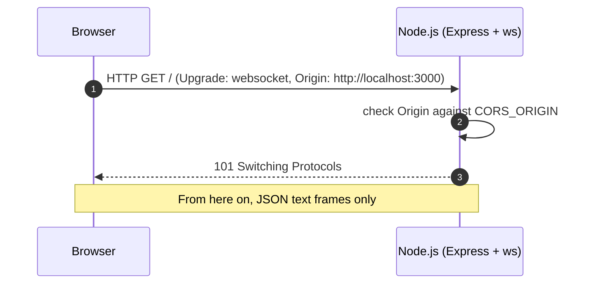
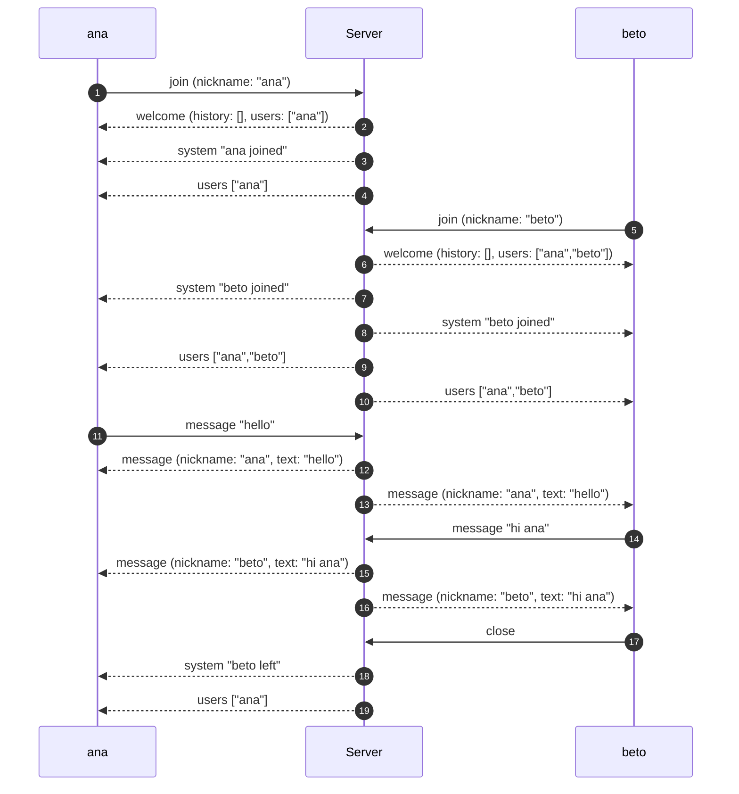

# WebSocket protocol

Complete reference for the frames exchanged between the browser and the
backend. The TypeScript source of truth is
[`backend/src/types.ts`](../backend/src/types.ts) (mirrored in
[`frontend/lib/chat-types.ts`](../frontend/lib/chat-types.ts)).

## Transport

| Property       | Value                                            |
| -------------- | ------------------------------------------------ |
| Endpoint       | `ws://localhost:3001` (configurable with `PORT`) |
| Subprotocol    | None                                             |
| Payload format | UTF-8 text frames containing JSON                |
| Max frame size | 16 KiB (`maxPayload`)                            |
| HTTP endpoint  | `GET /health` → `{ "ok": true, "clients": 2 }`   |

Binary frames are not part of the protocol and are rejected with
`INVALID_PAYLOAD`. Frames larger than 16 KiB make `ws` close the connection
with code `1009`.

## Handshake



The upgrade happens on the same port as the HTTP server. There is no CORS for
WebSocket: the browser sends an `Origin` header during the handshake and the
server compares it with the allowlist (`CORS_ORIGIN`, comma-separated). If it
does not match, the server closes with `1008`. Clients that send no `Origin`
(CLI tools, tests) are accepted.

## Client → server

### `join`

Claims a nickname and enters the room. Must be the first successful message
before sending any chat text.

```json
{ "type": "join", "nickname": "ana" }
```

| Field      | Type   | Rules                                                                      |
| ---------- | ------ | -------------------------------------------------------------------------- |
| `nickname` | string | Trimmed. 1–20 characters. No control characters. Unique, case-insensitive. |

Responses:

- Success: `welcome`, followed by a broadcast `system` notice and `users`.
- `INVALID_NICKNAME` if the nickname is empty, too long, or contains control
  characters.
- `NICKNAME_TAKEN` if another connected user already has it (any casing).
- `ALREADY_JOINED` if this socket already joined.

### `message`

Sends chat text to the room.

```json
{ "type": "message", "text": "hello there" }
```

| Field  | Type   | Rules                      |
| ------ | ------ | -------------------------- |
| `text` | string | Trimmed. 1–500 characters. |

Responses:

- Success: a `message` broadcast to every connected client, including the
  sender. The server assigns `id`, `nickname`, and `at`; the client does not.
- `NOT_JOINED` if the socket has not completed `join`.
- `INVALID_MESSAGE` if the text is empty or too long.
- `INVALID_PAYLOAD` if the frame is not JSON or has an unknown `type`.

## Server → client

### `welcome`

Sent once for every successful `join`, including automatic rejoins after a
reconnection. It is the client's resynchronization point.

```json
{
  "type": "welcome",
  "you": "ana",
  "history": [
    {
      "id": "0f4b6c1e-7d2a-4f5e-9c3b-1a2d3e4f5a6b",
      "nickname": "beto",
      "text": "hello",
      "at": 1730563200000
    }
  ],
  "users": ["ana", "beto"]
}
```

| Field     | Type            | Notes                                          |
| --------- | --------------- | ---------------------------------------------- |
| `you`     | string          | The nickname confirmed for this socket.        |
| `history` | `ChatMessage[]` | Last 100 messages, oldest first. May be empty. |
| `users`   | `string[]`      | Everyone currently joined, including `you`.    |

`history` contains chat messages only. `system` notices are never persisted, so
they disappear when the timeline is rebuilt from `welcome`.

### `message`

A chat message. Broadcast to all clients, sender included.

```json
{
  "type": "message",
  "message": {
    "id": "0f4b6c1e-7d2a-4f5e-9c3b-1a2d3e4f5a6b",
    "nickname": "beto",
    "text": "hello",
    "at": 1730563200000
  }
}
```

`id` is a UUID generated by the server, `at` is a Unix timestamp in
milliseconds, and `nickname` is taken from the sender's state (never from the
client payload).

### `system`

An ephemeral presence notice. Not stored, not replayed.

```json
{ "type": "system", "text": "beto joined", "at": 1730563200000 }
{ "type": "system", "text": "beto left", "at": 1730563260000 }
```

### `users`

The current presence list after somebody joins or leaves.

```json
{ "type": "users", "users": ["ana", "beto"] }
```

### `error`

A validation or protocol error. The connection stays open; the client can
correct the input and retry.

```json
{
  "type": "error",
  "code": "NICKNAME_TAKEN",
  "message": "That nickname is already taken"
}
```

## Error codes

| Code               | When it is sent                                        | Default message                                      |
| ------------------ | ------------------------------------------------------ | ---------------------------------------------------- |
| `INVALID_PAYLOAD`  | Binary frame, invalid JSON, or unknown `type`.         | `Message must be JSON text` / `Unknown message type` |
| `INVALID_NICKNAME` | Nickname empty, longer than 20, or with control chars. | `Nickname must be between 1 and 20 characters`       |
| `NICKNAME_TAKEN`   | Nickname already in use (case-insensitive).            | `That nickname is already taken`                     |
| `ALREADY_JOINED`   | A second `join` on the same socket.                    | `You are already in the chat`                        |
| `NOT_JOINED`       | `message` before a successful `join`.                  | `Join with a nickname first`                         |
| `INVALID_MESSAGE`  | Message empty or longer than 500 characters.           | `Message must be between 1 and 500 characters`       |

`message` is human-readable and may change. Switch on `code` for programmatic
behavior.

## Close codes

| Code   | Origin    | Meaning                                            |
| ------ | --------- | -------------------------------------------------- |
| `1000` | Client    | Normal closure (tab closed, page reloaded).        |
| `1001` | Server    | Server shutting down (`SIGINT`/`SIGTERM`).         |
| `1006` | Transport | Abnormal closure, including heartbeat termination. |
| `1008` | Server    | `Origin` not in the allowlist.                     |
| `1009` | `ws`      | Frame exceeded the 16 KiB `maxPayload`.            |

## Heartbeat

Every 30 seconds the server sends a WebSocket `ping` to each client. If a
socket did not answer the previous ping with `pong`, it is terminated. Browsers
answer `pong` automatically; application code does not need to handle it.

This detects connections that died without a close handshake (network switch,
suspended laptop, proxy timeout) and prevents zombie sockets from accumulating.

## Limits

| Limit               | Value  | Where                        |
| ------------------- | ------ | ---------------------------- |
| Nickname length     | 1–20   | `backend/src/chat.ts`        |
| Message length      | 1–500  | `backend/src/chat.ts`        |
| Stored history      | 100    | `backend/src/chat.ts`        |
| Frame size          | 16 KiB | `backend/src/server.ts`      |
| Heartbeat interval  | 30 s   | `backend/src/server.ts`      |
| Max reconnect delay | 30 s   | `frontend/hooks/use-chat.ts` |

## Example session



## Trying it by hand

From a browser console (the page origin must be allowed) or from Node.js 22+:

```js
const ws = new WebSocket("ws://localhost:3001")
ws.onmessage = (event) => console.log(JSON.parse(event.data))
ws.onopen = () => ws.send(JSON.stringify({ type: "join", nickname: "ana" }))
```

Then send a message:

```js
ws.send(JSON.stringify({ type: "message", text: "hello" }))
```

CLI clients that do not send an `Origin` header are accepted as well, which is
handy for quick experiments with tools like `wscat`.
